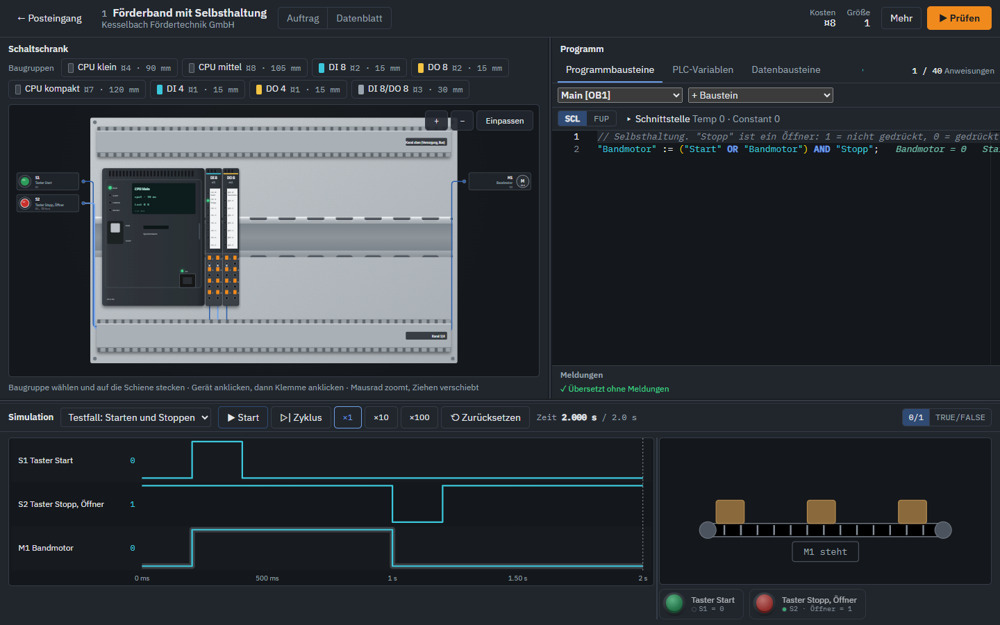

# ZYKLUS

**Steuerungsbau nach Auftrag** – ein Puzzle- und Lernspiel rund um speicherprogrammierbare
Steuerungen (SPS). Aufträge lesen, Baugruppen auf die Hutschiene stecken, Feldgeräte verdrahten,
in SCL, FUP, KOP oder GRAPH programmieren, simulieren und gegen Soll-Verläufe prüfen lassen.



_English below._

## Was drin ist

- **28 Aufträge** von „Licht an“ bis PID-Regelung, Schrittketten, Kommunikation zwischen CPUs und
  Bestandsanlagen, bei denen man fremde Fehler mit möglichst wenig Änderungen findet
- **Grundkurs für Einsteiger** ohne Vorkenntnisse: 11 Lektionen mit Quiz – Signale, Logik, Zyklus,
  Zeiten, Zähler, Schrittketten
- **Handbuch** zu allen Bausteinen, Befehlen und Online-Funktionen (Beobachten, Forcen, Trace)
- **Sandkasten**: eigene Anlagen bauen (Bänder, Zylinder, Sensoren, Tanks …), mit
  **Szenario-Editor** (Störungen, Stromausfall, Zeitleiste) und als eigener Auftrag veröffentlichen
- **Zufallsaufträge** mit Auftragscode zum Weitergeben, jeder vorab mit einer Musterlösung geprüft
- Deutsch und Englisch, läuft komplett offline

## Installieren

### Windows

**Download:** Installer `ZYKLUS_…_x64-setup.exe` aus dem
[neuesten Release](https://github.com/Ollleey/Zyklus/releases/latest) laden und starten (ohne
Adminrechte). Ohne Installation geht die portable `ZYKLUS_…_x64_portable.exe`.

**Oder mit einem Befehl** (PowerShell):

```powershell
irm https://raw.githubusercontent.com/Ollleey/Zyklus/main/scripts/install.ps1 | iex
```

Windows 10/11 mit WebView2 (ist dort vorinstalliert). Der Installer ist nicht signiert – die
SmartScreen-Warnung mit „Weitere Informationen → Trotzdem ausführen“ bestätigen.

### Linux (x86_64)

```bash
curl -fsSL https://raw.githubusercontent.com/Ollleey/Zyklus/main/scripts/install.sh | bash
```

Legt `~/.local/bin/zyklus.AppImage` und einen Eintrag im Anwendungsmenü an. Alternativ das
`ZYKLUS_…_amd64.AppImage` aus dem [Release](https://github.com/Ollleey/Zyklus/releases/latest)
laden, `chmod +x` und starten. Fehlt FUSE 2: `libfuse2` installieren (Ubuntu 24.04:
`libfuse2t64`) oder mit `--appimage-extract-and-run` starten. Entfernen:
`bash install.sh --uninstall`.

### Im Browser

```bash
git clone https://github.com/Ollleey/Zyklus.git
cd Zyklus
npm install
npm run dev -w @zyklus/game
```

Dann <http://localhost:5173> öffnen (Node.js 22 oder neuer).

## Updates

In der Desktop-App unter **🔧 Einstellungen → Nach Updates suchen**. Gibt es eine neue Version,
fragt das Spiel nach; mit **Ja** wird sie heruntergeladen, installiert und das Spiel neu gestartet.
Auf Wunsch sucht es auch beim Start (Häkchen in den Einstellungen) – sonst geht das Spiel nie ins
Internet. Updates sind signiert; die App installiert nur Pakete aus diesem Repository.

## Spielstände

Spielstände bleiben bei Updates und beim Deinstallieren erhalten:

| System  | Ort                                                                         |
| ------- | --------------------------------------------------------------------------- |
| Windows | `%APPDATA%\de.zyklus.spiel\`, Anlagen in `Dokumente\ZYKLUS\Anlagen\`        |
| Linux   | `~/.local/share/de.zyklus.spiel/`, Anlagen in `~/Dokumente/ZYKLUS/Anlagen/` |
| Browser | `localStorage` des Browsers                                                 |

Umzug oder Sicherung: im Posteingang **Spielstand → Alles exportieren**, in der Desktop-App
importieren.

## Entwicklung

```bash
npm install
npm test            # alle Tests
npm run typecheck
npm run dev:desktop # Desktop-App (braucht Rust und unter Windows die VS Build Tools C++)
npm run build:desktop
```

| Paket                   | Inhalt                                                                                       |
| ----------------------- | -------------------------------------------------------------------------------------------- |
| `packages/sim-core`     | SPS-Simulation (IR, Interpreter, Zyklus, Timer/Zähler), Schaltschrank, Signale, Verifikation |
| `packages/scl-compiler` | SCL-Lexer/Parser, Typprüfung, Codegen, Import/Export von `.scl`-Quellen                      |
| `packages/fup-model`    | FUP/KOP-Modell, GRAPH-Schrittketten, Boxkatalog, Absenkung nach SCL                          |
| `packages/levels`       | Aufträge als JSON (mit englischer Überlagerung), Referenzlösungen, Tests                     |
| `packages/plant-sim`    | Sandkasten: Anlagenmodell, Mechanik, Sensoren, Dateiformat, Szenarien                        |
| `packages/zufall`       | Zufallsaufträge: Auftragscode, Baupläne mit Musterlösung                                     |
| `packages/platform`     | Plattformschicht Web/Desktop: Speicher, Dateien, Fenster, Updates                            |
| `apps/game`             | React-App (Vite, Monaco)                                                                     |
| `apps/desktop`          | Tauri-Hülle der Desktop-App, E2E-Test                                                        |

Dokumentation: Handbuch-Seiten in [docs/](docs) (Englisch in [docs/en/](docs/en)), Grundkurs in
[docs/grundkurs/](docs/grundkurs), Desktop-App und Releases in
[docs/desktop/README.md](docs/desktop/README.md), Änderungen in [CHANGELOG.md](CHANGELOG.md).

---

## English

**ZYKLUS** is a puzzle and learning game about programmable logic controllers (PLCs): read jobs,
fit modules on a DIN rail, wire field devices, program in SCL, FBD, LAD or GRAPH, simulate and have
your solution verified. It includes 28 jobs, a basics course for complete beginners, a handbook, a
sandbox with scenario editor and random jobs. The interface is available in German and English
(choose at the top of the inbox).

**Install on Windows:** download the `…_x64-setup.exe` from the
[latest release](https://github.com/Ollleey/Zyklus/releases/latest), or run in PowerShell:

```powershell
irm https://raw.githubusercontent.com/Ollleey/Zyklus/main/scripts/install.ps1 | iex
```

**Install on Linux (x86_64):**

```bash
curl -fsSL https://raw.githubusercontent.com/Ollleey/Zyklus/main/scripts/install.sh | bash
```

**Updates:** in the desktop app under **🔧 Settings → Check for updates**; confirm with **Yes** to
download, install and restart. Save games are kept across updates.

**Run from source:** `npm install`, then `npm run dev -w @zyklus/game` and open
<http://localhost:5173>.

---

## Lizenz / License

**Gemeinfrei** ([Unlicense](LICENSE)): Jeder darf ZYKLUS kopieren, ändern, weitergeben und
verwenden – auch kommerziell, ohne Nachfrage und ohne Namensnennung. / **Public domain**: anyone may
copy, modify, distribute and use ZYKLUS for any purpose, without asking and without attribution.

Mitgelieferte Fremdbestandteile behalten ihre eigenen Lizenzen, z. B. die Schriften IBM Plex (SIL
Open Font License) und die npm- und Rust-Pakete. / Bundled third-party parts keep their own licences,
e.g. the IBM Plex fonts (SIL Open Font License) and the npm and Rust packages.

ZYKLUS ist ein eigenständiges Hobbyprojekt mit eigenen Grafiken und Texten. Es ist nicht mit der
Siemens AG verbunden und nicht von ihr unterstützt; die Spiel-SPS ist an verbreitete
Programmiersprachen nach IEC 61131-3 angelehnt, ohne Anspruch auf Kompatibilität. Genannte Marken
gehören ihren Inhabern. / ZYKLUS is an independent hobby project and is not affiliated with or
endorsed by Siemens AG or any other company.
