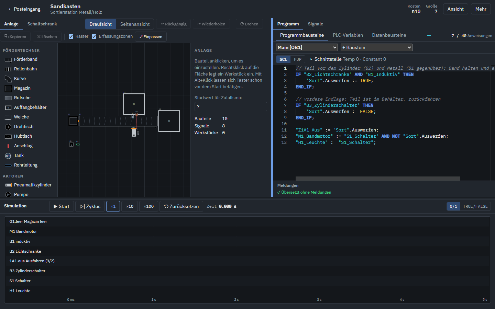
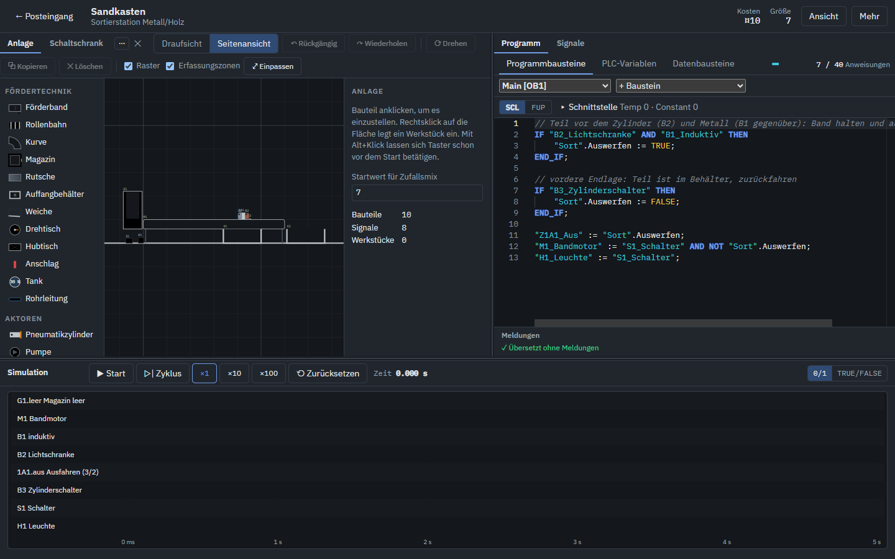
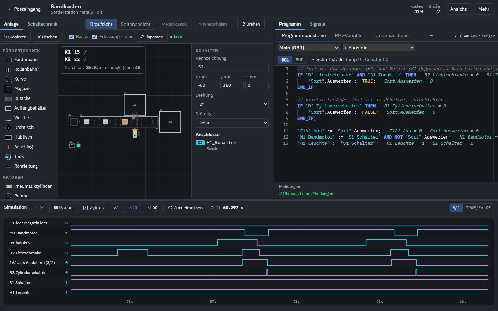
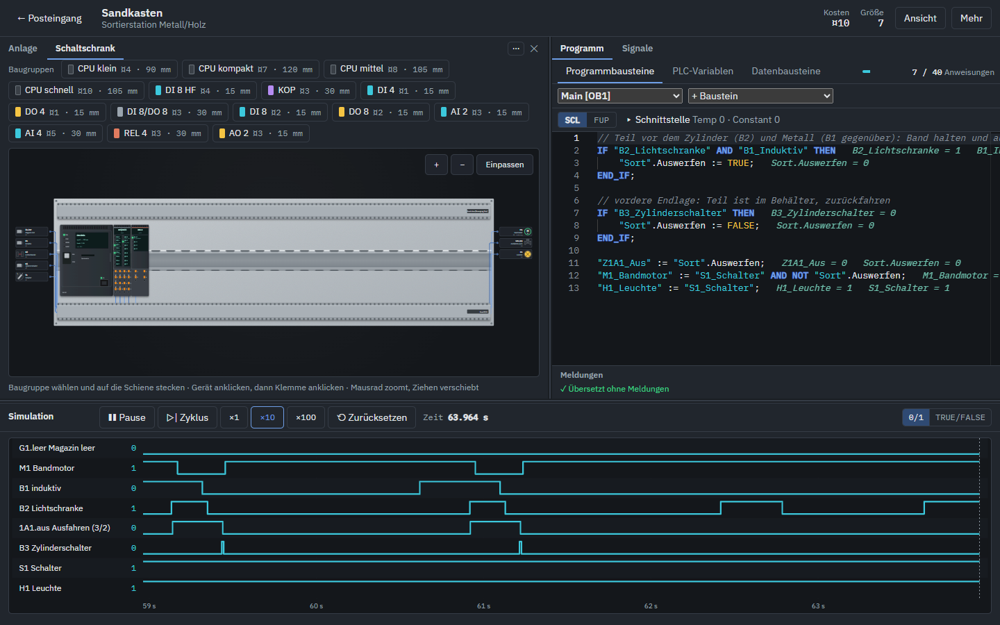
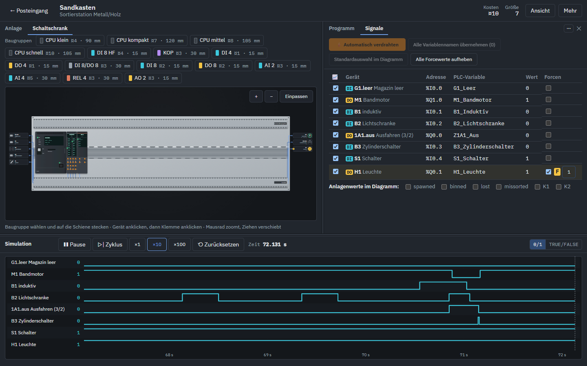
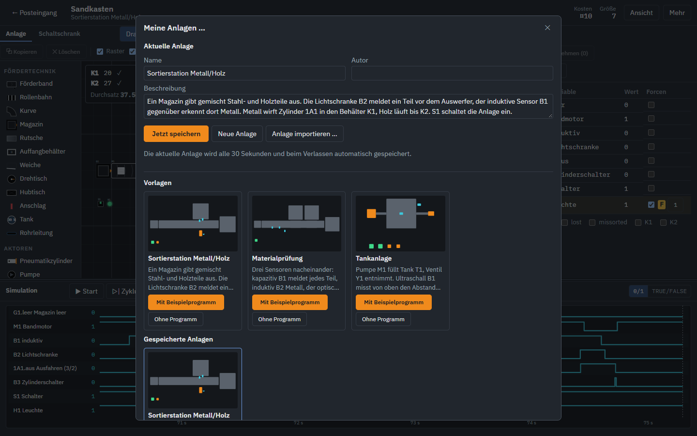
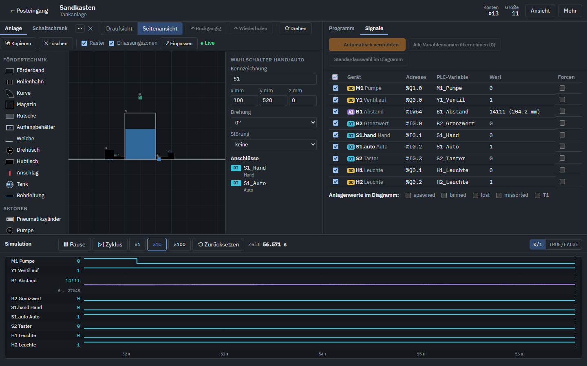
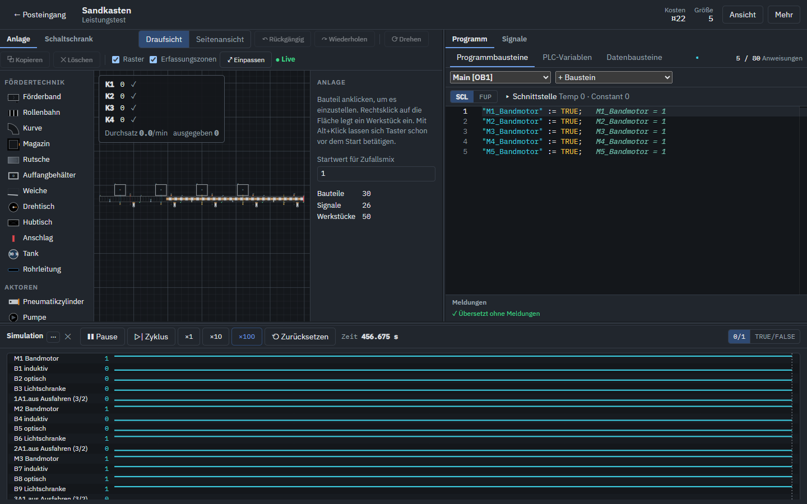

# Sandkasten

Eigene Anlage bauen, verdrahten, programmieren und live simulieren. Der Plan steht in
[PLAN.md](PLAN.md), die Anweisung in `Sandbox_Anweisung.txt`.

## Aufbau

- `packages/plant-sim` (ohne UI): Datenmodell, Werkstoffe, Bauteilkatalog, Mechanik mit festem
  2-ms-Schritt (`world.ts`), Sensor-Physik als reine Funktionen (`sensors.ts`), Anschlüsse als
  Feldgeräte (`devices.ts`), `SandboxPlant` für `LevelRun` (`plant.ts`), Dateiformat
  `*.anlage.json` mit zod (`file.ts`), Vorlagen (`templates.ts` → `vorlagen/*.anlage.json`).
- Die Anlage wird zur Laufzeit ein gewöhnliches Level: Schaltschrank, Compiler und SPS sind
  dieselben wie in der Kampagne. Neu in sim-core: erweiterbare Anlagenmodelle, Forcen,
  `Device.label`, Drahtbruch aus dem Modell, „Automatisch verdrahten“.
- App: bewegliche Panels (`ui/Dock.tsx`, auch für die Aufträge), Anlageneditor
  (`components/plant`), Panel „Signale“, „Meine Anlagen“.

## Vorlagen

| Datei                                 | Inhalt                                                                      |
| ------------------------------------- | --------------------------------------------------------------------------- |
| `sortierstation(-leer).anlage.json`   | Magazin, Band, induktiver Sensor, Lichtschranke, Auswerfer, zwei Behälter   |
| `materialpruefung(-leer).anlage.json` | kapazitiv, induktiv, optisch nacheinander, zwei Weichen, drei Behälter      |
| `tankanlage(-leer).anlage.json`       | Pumpe, Ventil, Ultraschall von oben (4–20 mA), Grenzwertschalter, Hand/Auto |

Die Dateien erzeugt `packages/plant-sim/test/templates.test.ts` aus `templates.ts`
(`ZYKLUS_VORLAGEN=1 npx vitest run test/templates.test.ts` im Paket schreibt sie neu).

## Prüfung

- Pflichttests der Sensor-Physik: `packages/plant-sim/test/sensors.test.ts`
- Integration: Vorlage 1 sortiert 100 Teile (Seed 7) ohne Fehlsortierung, Materialprüfung trennt
  alle zwölf Teile richtig, Tankanlage regelt zwischen 40 und 70 % (`integration.test.ts`)
- Determinismus, Round-Trip Export → Import, Migration, Störungen, Leistung
- Screenshots und Bildratenmessung: `node scripts/sandbox-shots.mjs docs/sandbox
http://localhost:5173 http://localhost:4173` (Dev-Server und `npm run preview` laufen);
  Ergebnis in [leistung.txt](leistung.txt)

## Screenshots

|                                                 |                                                       |
| ----------------------------------------------- | ----------------------------------------------------- |
|  |  |
|   |                 |
|  |                 |
|   |                 |

## Bekannte Grenzen

- Werkstücke sind achsparallele Quader und drehen sich nicht; Auflage nach der Mitte des Teils.
- Der Sandkasten rechnet in einem Web Worker; im Extremfall erreicht er etwa ×70 statt ×100 (siehe [leistung.txt](leistung.txt)); die
  Darstellung zeigt je Bild den aktuellen Stand, ohne Zwischenbilder zu interpolieren.
- Ein-/Ausgänge werden als elektrischer Wert bzw. Rohwert geforct; Prüfläufe der Kampagne
  kennen kein Forcen.
